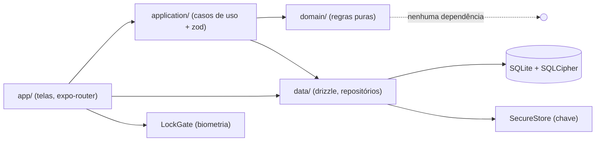
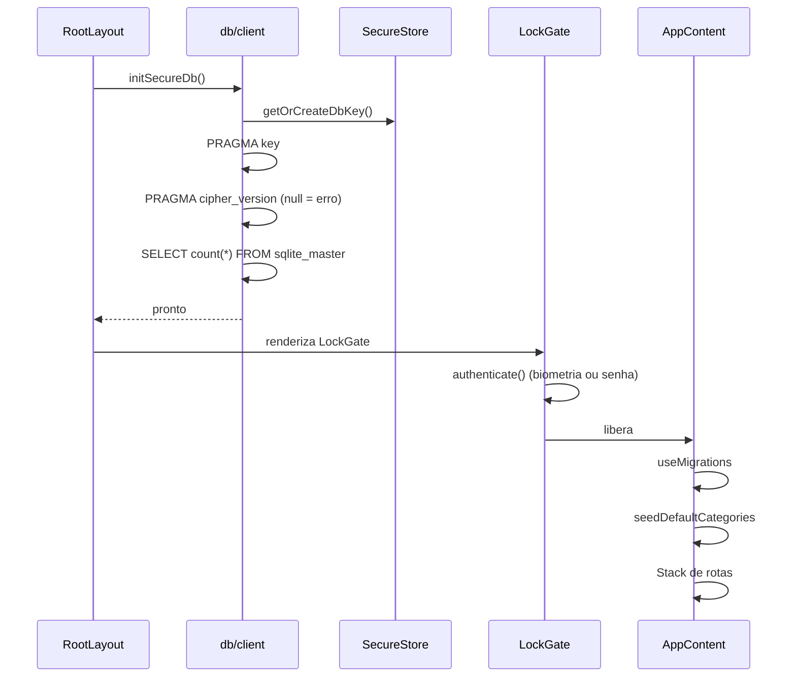
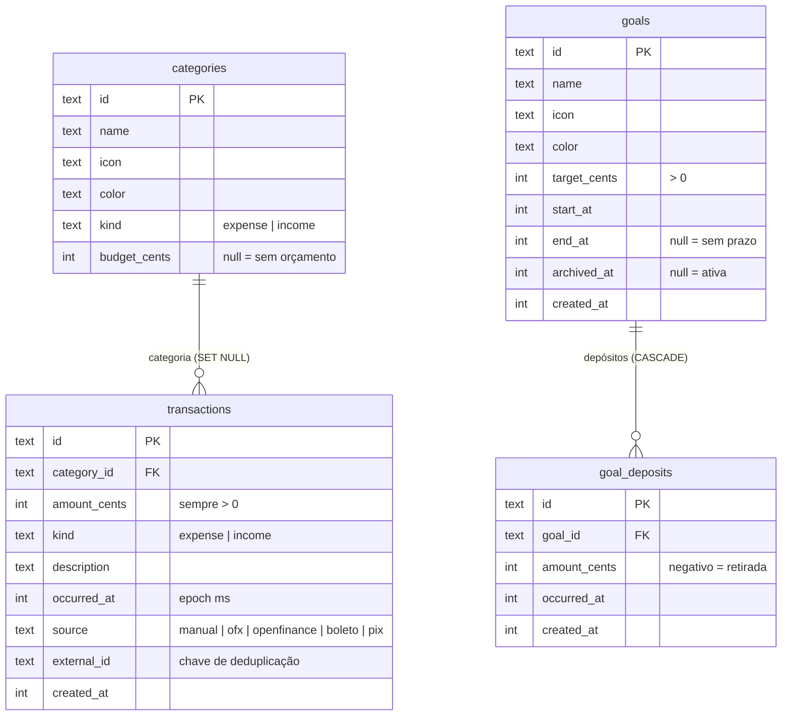
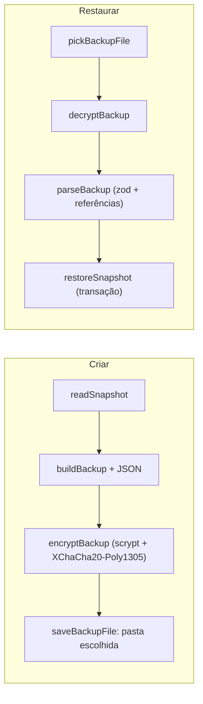

# Arquitetura do appBank

Este documento explica **como o app é organizado e por quê**. Para rodar o projeto, veja o [README](../README.md).

## Sumário

1. [Princípios](#1-princípios)
2. [Visão geral](#2-visão-geral)
3. [Camadas e regras de dependência](#3-camadas-e-regras-de-dependência)
4. [Boot do app](#4-boot-do-app)
5. [Segurança](#5-segurança)
6. [Modelo de dados](#6-modelo-de-dados)
7. [Dinheiro](#7-dinheiro)
8. [Regras de negócio](#8-regras-de-negócio)
9. [Importações](#9-importações)
10. [Navegação](#10-navegação)
11. [Estratégia de testes](#11-estratégia-de-testes)
12. [Decisões de projeto](#12-decisões-de-projeto)
13. [Dívida técnica e riscos](#13-dívida-técnica-e-riscos)
14. [Como estender](#14-como-estender)
15. [Backup](#15-backup)

## 1. Princípios

- **Local-first.** Os dados ficam no aparelho. Não há servidor, login nem telemetria. A única saída é o arquivo de backup, sempre cifrado e por ação explícita do usuário.
- **Seguro por padrão.** Sem criptografia ativa, o app se recusa a abrir (falha fechada).
- **Dinheiro é inteiro.** Valores são centavos inteiros; `float` só aparece na formatação.
- **Regras puras, I/O nas bordas.** A lógica de negócio não toca banco, rede nem UI.
- **Validar na fronteira.** Tudo que vem da UI passa por `zod` antes de chegar ao banco.

## 2. Visão geral



Observação: as telas leem direto da camada `data` com `useLiveQuery` (drizzle), para que as listas reativas atualizem sozinhas quando o banco muda. As escritas passam por `application`, com uma exceção: `deposit.tsx` chama `archiveGoal` (de `data/goalRepository`) diretamente, sem validação. Isso está listado na [dívida técnica](#13-dívida-técnica-e-riscos).

## 3. Camadas e regras de dependência

| Camada | Pasta | Responsabilidade | Pode importar |
| --- | --- | --- | --- |
| Domínio | `src/domain` | Regras de negócio puras: dinheiro, orçamento, metas, alertas, conquistas, parsers de boleto/OFX/PIX. Sem I/O. | Só `domain` e libs puras (`date-fns`) |
| Dados | `src/data` | Schema, conexão, migrations, repositórios, auth biométrica, seed, leitura de arquivo OFX. | `domain` |
| Aplicação | `src/application` | Casos de uso: validam entrada (`zod`), convertem texto em centavos e chamam repositórios. | `domain`, `data` |
| Apresentação | `src/app`, `src/components` | Telas, navegação, estado de UI. | todas as anteriores |

**Regra:** a seta só aponta para dentro. `domain` nunca importa `data`, `application` ou `app`. É isso que permite testar a regra de negócio com `npx tsx`, sem emulador.

### Mapa de arquivos

```
src/domain/
  money.ts            Cents, parseToCents, sumCents, formatBRL, isValidCents
  types.ts            Category, Transaction, TransactionKind, TransactionSourceKind
  period.ts           currentMonth, previousMonths
  budgetStatus.ts     none | ok | warning | over
  goal.ts             goalProgress (ratio, restante, meta mensal)
  goalAlert.ts        alertas e marcos de progresso
  savingsSuggestion.ts sugestão de economia mensal
  achievements.ts     5 selos derivados
  boleto.ts           linha digitável -> valor e vencimento
  ofx.ts              parser de extrato OFX
  pixReceipt.ts       heurística de comprovante PIX
src/data/
  db/schema.ts        tabelas (drizzle)
  db/client.ts        conexão + initSecureDb
  db/secureKey.ts     geração e guarda da chave
  db/migrations/      .sql + journal + migrations.js
  auth.ts             biometria / senha do aparelho
  seed.ts             categorias padrão
  ofxFile.ts          seletor de arquivo OFX
  transactionRepository.ts, goalRepository.ts, analyticsRepository.ts
src/application/
  addExpense.ts, setBudget.ts, manageGoals.ts, importOfx.ts,
  importFromDocument.ts, savingsInsight.ts, achievementsInsight.ts
```

## 4. Boot do app

A ordem importa: nenhuma consulta pode rodar antes do banco estar destravado.



Estados de tela durante o boot (`src/app/_layout.tsx`):

1. "Protegendo seus dados…" enquanto `initSecureDb` roda.
2. Tela de erro com 🔒 se a criptografia falhar.
3. `LockGate` pede biometria.
4. "Preparando seus dados…" durante migrations e seed.
5. "Erro ao preparar o banco" se a migration falhar.

## 5. Segurança

### Criptografia em repouso

- O plugin `expo-sqlite` com `useSQLCipher: true` compila o SQLCipher no binário.
- `secureKey.ts` gera **32 bytes aleatórios** (`expo-crypto`), grava em hexadecimal no `expo-secure-store` com `WHEN_UNLOCKED_THIS_DEVICE_ONLY` e reutiliza nas próximas aberturas. A chave não é logada.
- `initSecureDb` aplica `PRAGMA key`, confere `PRAGMA cipher_version` e faz uma leitura de `sqlite_master` para validar a chave.

### Falha fechada

Se `PRAGMA cipher_version` não retornar nada, o SQLCipher não está no binário (típico do Expo Go). Nesse caso o `PRAGMA key` é ignorado em silêncio e os dados seriam gravados **em texto puro**. Por isso o app lança erro e não abre.

### Bloqueio da interface

`LockGate` chama `authenticate()` (`expo-local-authentication`) na abertura e **toda vez que o app volta do segundo plano** (`inactive`/`background` para `active`).

| Resultado | Comportamento |
| --- | --- |
| `success` | Desbloqueia. |
| `failed` | Mantém bloqueado, mostra aviso e o botão "Desbloquear". |
| `unavailable` | **Desbloqueia.** O aparelho não tem biometria ou senha cadastrada. |

O fallback para senha do aparelho está habilitado (`disableDeviceFallback: false`).

**Cobertura, não desmontagem.** Antes do primeiro desbloqueio, nenhuma tela é montada (nenhuma consulta roda). Depois dele, rebloquear **cobre** o app com uma camada opaca, em vez de desmontá-lo. Ao desmontar, a navegação voltava para a primeira aba e qualquer operação em andamento se perdia. Isso acontecia toda vez que um seletor de arquivo do sistema mandava o app para segundo plano no meio de um backup. Enquanto bloqueado, o conteúdo coberto fica oculto para leitores de tela e não recebe toques.

### Pontos de atenção

- `unavailable` libera o acesso. Num aparelho sem tela de bloqueio, qualquer pessoa abre o app. A proteção em repouso (SQLCipher) continua valendo, mas a chave é lida sem desafio.
- Não há rotação de chave, e a chave do banco nunca sai do aparelho. Perdê-la (ou limpar os dados do app) torna o banco ilegível; os dados só voltam por um [backup](#15-backup).
- O comportamento do SecureStore no Android não foi auditado neste projeto; o comentário no código fala em Keychain (iOS).

## 6. Modelo de dados



Índices: `idx_tx_occurred (occurred_at)`, `uq_tx_source_external (source, external_id)` único, `idx_goal_active (archived_at)`, `idx_deposit_goal (goal_id)`.

Pontos que valem saber:

- **Datas** são `integer` em milissegundos desde a época, em horário local do aparelho.
- **Importação idempotente:** o índice único `(source, external_id)` mais `onConflictDoNothing` impede duplicar a mesma transação importada.
- **Saldo de uma meta** = soma de `goal_deposits.amount_cents`. Não existe coluna "guardado"; ela seria redundante e poderia divergir.
- **Conquistas** não têm tabela: são recalculadas a cada abertura da tela.
- **IDs** são `Date.now()` em base 36 mais aleatório (`randomId`, duplicado em `transactionRepository.ts` e `goalRepository.ts`). Servem para unicidade local, não como token de segurança.
- `source` aceita `openfinance`, mas nada no código grava esse valor hoje.

### Migrations

Fluxo: editar `schema.ts` → `npx drizzle-kit generate` → commitar `.sql`, `_journal.json` e `migrations.js`. Em runtime, `useMigrations(db, migrations)` aplica o que falta. Os `.sql` entram no bundle como string por `babel-plugin-inline-import` (`babel.config.js`) e `sourceExts` do Metro (`metro.config.js`).

Se uma migration falhar no meio (por exemplo, o app foi fechado durante a primeira execução), o banco pode ficar com tabelas criadas e sem registro no journal. O erro aparece como `Failed to run the query 'CREATE TABLE ...'`. Veja o aviso no README antes de limpar dados.

## 7. Dinheiro

- Tipo: `Cents` = `number` inteiro. Nunca `float` em armazenamento nem soma.
- `parseToCents(texto)` aceita `R$ 1.234,56`, `1234,56` e `19.9`. Remove símbolo e espaços, descarta separador de milhar (ponto seguido de 3 dígitos), troca vírgula decimal por ponto e monta os centavos **com partes inteiras**, sem multiplicar float por 100. Arredonda a terceira casa (meio para cima). Retorna `NaN` se inválido.
- `sumCents` é soma inteira exata.
- `formatBRL` é o único lugar com divisão por 100 (`toLocaleString('pt-BR', BRL)`).
- No SQL, somas usam `coalesce(sum(...), 0)` sobre inteiros.
- Limite prático: `Number.MAX_SAFE_INTEGER` centavos (cerca de 90 trilhões de reais). Irrelevante aqui.

## 8. Regras de negócio

### Lançamento (`addExpense`)

- `amountText` obrigatório; convertido por `parseToCents`; deve ser inteiro **maior que zero**.
- `kind`: `expense` ou `income`. `description` até 140 caracteres, com `trim`.
- `occurredAt` padrão: agora. `source` padrão: `manual`.

### Orçamento (`budgetStatus`)

Orçamento é por categoria, mensal (mês calendário), em `categories.budget_cents`.

| Condição | Nível | Mensagem |
| --- | --- | --- |
| sem orçamento ou `<= 0` | `none` | nenhuma |
| `gasto > orçamento` | `over` | "Você estourou o limite deste mês." |
| `gasto * 100 >= orçamento * 70` | `warning` | "Você está chegando ao limite, cuidado." |
| demais | `ok` | nenhuma |

A comparação é feita em inteiros, para não haver erro de ponto flutuante exatamente no limiar de 70%. Gasto **igual** ao orçamento é `warning`, não `over`. `setBudget` aceita texto vazio para remover o orçamento e rejeita valores negativos.

### Metas (`goalProgress`)

- `restante = max(0, alvo - guardado)`
- `ratio = clamp(guardado / alvo, 0, 1)`; se `alvo <= 0`, `ratio = 1`
- `concluída` quando `guardado >= alvo` e `alvo > 0`
- Com prazo (`endAt`): `mesesRestantes = max(1, diferençaEmMesesCalendário(endAt, hoje) + 1)` e `metaMensal = ceil(restante / mesesRestantes)` (0 se concluída). O `+1` conta o mês corrente; o mínimo de 1 evita divisão por zero.
- Criação: nome de 1 a 80 caracteres; alvo `> 0`; `endAt` não pode ser anterior a `startAt`.
- Depósito: valor **diferente de zero**; negativo é retirada.

### Alertas de meta (`goalAlerts`)

1. Meta concluída: "Meta concluída! 🎉" e para por aí.
2. Marcos 25%, 50%, 75% e 90%: ao atingir qualquer um, mostra "Você está a X% da sua meta" (X = percentual real, arredondado para baixo).
3. Nada guardado no mês: aviso de atenção. Com prazo, a mensagem pede um aporte para manter o prazo.

### Sugestão de economia (`suggestSavings`)

- Amostra: até 3 meses completos anteriores (`HISTORY_MONTHS = 3`).
- `sobraMédia = round(Σ(entradas - saídas) / nMeses)`.
- `folgaOrçamento = max(0, orçamentoTotal - despesaDoMêsAtual)`, só se houver orçamento.
- `sugerido = max(0, round(max(0, sobraMédia) * 0,5) + round(folga * 0,5))`.
- `lowConfidence` quando há menos de 2 meses de histórico.
- Nunca sugere valor negativo. É uma heurística de apoio, e a interface deve deixar isso claro.

### Conquistas (`computeAchievements`)

| Id | Título | Regra |
| --- | --- | --- |
| `first-transaction` | Primeiro passo | 1 ou mais lançamentos |
| `first-goal` | Sonhador | 1 ou mais metas criadas |
| `goal-completed` | Objetivo alcançado | 1 ou mais metas concluídas |
| `within-budget` | No controle | Existe orçamento e nenhuma categoria com orçamento está em `over` neste mês |
| `saved-1k` | Cofrinho cheio | Total guardado `>= R$ 1.000,00` (100.000 centavos) |

## 9. Importações

Todas as importações passam por `src/application`, gravam com `source` correspondente e **não definem categoria**.

### Boleto bancário (`parseBoleto`)

- Entrada: linha digitável com **47 dígitos** (outros caracteres são ignorados). Começando com `8` (concessionária) é rejeitado.
- A linha digitável é convertida no código de barras de 44 dígitos, descartando os dígitos verificadores dos três primeiros campos.
- Valor: últimos 10 dígitos, já em centavos.
- Vencimento: fator de 4 dígitos × 1 dia, a partir de **07/10/1997**. Fator `0000` significa sem vencimento (`null`).
- **Reinício do fator:** depois de 9999 (21/02/2025) o fator volta a 1000, num ciclo de 9000 dias. Um fator entre 1000 e 9999 é, portanto, ambíguo (ex.: 1627 pode ser jul/2002 ou nov/2026). `parseBoleto(raw, now)` calcula as duas datas e escolhe a **mais próxima de `now`**, partindo da premissa de que um boleto é lido perto do vencimento. Fatores abaixo de 1000 só existem no primeiro ciclo. O parâmetro `now` é injetável para teste.
- **Não valida** os dígitos verificadores.

### PIX (`parsePixReceipt`)

Heurística sobre texto colado. Valor: o **maior** `R$ x,xx` encontrado (comprovantes costumam trazer taxas menores). Data: primeira `dd/mm/aaaa` ou `dd/mm/aa`. Favorecido: texto após uma linha com "para", "destinat…", "recebedor" ou "favorecido", limitado a 80 caracteres. O usuário revisa antes de salvar.

### OFX (`parseOfx`, `importOfx`)

- Lê blocos `<STMTTRN>`; ignora os que não têm `TRNAMT` ou `DTPOSTED` válidos.
- Valor negativo vira `expense` e positivo vira `income`, sempre guardado em módulo.
- `FITID` é a chave de deduplicação; se ausente, usa uma chave sintética `data-valor-memo`.
- Descrição: `MEMO`, senão `NAME`, senão "Importado".
- Reimportar o mesmo arquivo não duplica: `importTransactions` retorna quantas linhas **de fato** entraram (contagem depois menos antes).

## 10. Navegação

| Rota | Arquivo | Tipo |
| --- | --- | --- |
| `/` | `(tabs)/index.tsx` | Aba Resumo |
| `/goals` | `(tabs)/goals.tsx` | Aba Metas |
| `/budgets` | `(tabs)/budgets.tsx` | Aba Orçamento |
| `/add` | `add.tsx` | Modal "Novo lançamento" |
| `/goal-new` | `goal-new.tsx` | Modal "Nova meta" |
| `/deposit` | `deposit.tsx` | Modal "Guardar na meta" (`goalId`) |
| `/import` | `import.tsx` | Modal "Importar boleto / PIX" (+ OFX) |
| `/achievements` | `achievements.tsx` | Tela "Conquistas" |
| `/backup` | `backup.tsx` | Modal "Backup" (💾 no Resumo) |

Esquema de deep link: `appbank://`. O `_layout.tsx` raiz só monta a pilha depois de banco destravado, desbloqueio biométrico, migrations e seed.

## 11. Estratégia de testes

Os testes cobrem a camada `domain`, onde está o risco financeiro. São arquivos executáveis com `assert` simples, rodados por `npx tsx`, sem framework, fixtures nem configuração.

| Arquivo | Garante |
| --- | --- |
| `money.test.ts` | Conversão e soma exatas, sem deriva de float |
| `boleto.test.ts` | Valor e vencimento da linha digitável, incluindo o reinício do fator em 2025; PIX |
| `budgetStatus.test.ts` | Limiares de 70% e 100% |
| `goal.test.ts` | Progresso, restante e meta mensal |
| `goalAlert.test.ts` | Marcos e alertas |
| `ofx.test.ts` | Parser de OFX |
| `backupCrypto.test.ts` | Cifra do backup: senha errada e adulteração nunca abrem |
| `backup.test.ts` | Formato do backup: validação e referências |

Rodam com `npm test` (`scripts/test.mjs` executa cada `*.test.ts` com `tsx`). O CI no GitHub Actions executa `typecheck`, `lint` e `test`.

Sem cobertura: `period`, `achievements`, `savingsSuggestion`, `application`, `data` e UI. O `pixReceipt` é coberto dentro de `boleto.test.ts`.

## 12. Decisões de projeto

| Decisão | Motivo | Consequência |
| --- | --- | --- |
| Local-first, sem backend | Privacidade e simplicidade; app pessoal de um único usuário | Sem sincronização nem backup automático |
| Backup em arquivo cifrado, não Supabase | Resolve a troca de aparelho sem servidor, conta ou LGPD | Manual; o usuário guarda arquivo e senha |
| SQLCipher + chave no SecureStore | Proteger dados financeiros em repouso | Exige development build; chave presa ao aparelho |
| Falhar se não houver criptografia | Evitar falsa sensação de segurança | App não abre no Expo Go |
| Centavos inteiros | Evitar erros de float | Conversão obrigatória nas bordas |
| `domain` puro | Testar regras sem emulador | Disciplina de não importar I/O |
| `zod` só em `application` | Uma única fronteira de confiança | Telas não validam por conta própria |
| Conquistas derivadas | Nada para migrar ou dessincronizar | Recalculadas em toda abertura |
| Saldo de meta = soma de depósitos | Uma fonte de verdade | Consulta agregada por meta |
| Migrations embutidas no bundle | Funciona offline e no boot | Atualizar `migrations.js` a cada migration |
| Testes sem framework | Menor custo de manutenção | Sem relatório agregado nem watch |

## 13. Dívida técnica e riscos

Ordenados por impacto:

1. **Backup só manual.** Depende de o usuário lembrar de exportar; o que for registrado depois do último backup se perde com o aparelho. Lembrete periódico seria o próximo passo.
2. **Fator de vencimento do boleto:** a escolha do ciclo por proximidade falha para boletos pagos muito antes ou muito depois do vencimento (mais de 4.500 dias, cerca de 12 anos, de distância). Na prática é irrelevante.
3. **Chaves estrangeiras** possivelmente desativadas: o código não executa `PRAGMA foreign_keys = ON`. Verificar o padrão do `expo-sqlite` e, se necessário, ativar após o `PRAGMA key`.
4. **Sem `CHECK` no banco** para `amount_cents > 0` e `target_cents > 0`.
5. **`unavailable` desbloqueia** o app em aparelho sem tela de bloqueio.
6. **Sem edição ou exclusão** de lançamentos, nem CRUD de categorias.
7. **`randomId` duplicado** em dois repositórios.
8. **Escrita fora de `application`:** `deposit.tsx` chama `archiveGoal` direto do repositório.
9. **Consultas sem filtro de período:** o Resumo e o Orçamento carregam a tabela `transactions` inteira em memória (`db.select().from(schema.transactions)`) e filtram o mês no cliente. Funciona com poucos dados, mas degrada com anos de histórico; o ideal é filtrar por `occurred_at` no SQL (já existe índice).
10. **iOS não validado**; ícones e splash são placeholders.
11. **Peer dependencies:** `react-dom` está fixado em 19.3.0 só para o `npm ci` resolver (o app não usa web). Revisar ao atualizar o SDK.

## 14. Como estender

### Nova regra de negócio

1. Criar o arquivo em `src/domain/` como função pura, sem imports de `data`.
2. Criar `nome.test.ts` ao lado, com `assert` simples, e rodar com `npx tsx`.
3. Se precisar de dados, adicionar função no repositório e orquestrar em `src/application/`.

### Nova coluna ou tabela

1. Editar `src/data/db/schema.ts`.
2. `npx drizzle-kit generate`.
3. Commitar `.sql`, `meta/_journal.json` e `migrations.js`.
4. Testar num app limpo **e** num app com dados da versão anterior.

### Nova tela

1. Criar o arquivo em `src/app/`; a rota nasce do nome do arquivo.
2. Se for modal, registrar em `_layout.tsx` com `presentation: 'modal'`.
3. Escritas via caso de uso em `src/application/`, nunca direto no repositório.
4. Dentro de `<Link asChild>`, não passe array de estilos para o filho: use `StyleSheet.flatten`.

### Nova fonte de importação

1. Parser puro em `domain/` com teste.
2. Caso de uso em `application/` que monte `ImportRow[]` e chame `importTransactions(rows, source)`.
3. Garantir `externalId` estável para a deduplicação funcionar.
4. Se for um `source` novo, incluí-lo no enum do schema (gera migration) e no `zod` de `addExpense`.

## 15. Backup

Objetivo: levar os dados para outro aparelho (troca de iPhone) sem servidor. Copiar o arquivo do banco não serve, porque a chave do SQLCipher é `WHEN_UNLOCKED_THIS_DEVICE_ONLY` e não sai do aparelho. O backup é, portanto, uma **exportação lógica** das tabelas, cifrada com uma senha do usuário.

### Fluxo



| Camada | Arquivo | Papel |
| --- | --- | --- |
| domain | `backupCrypto.ts` | Envelope cifrado. Puro: sal e nonce são injetados. |
| domain | `backup.ts` | Formato e validação (`zod`) do conteúdo. |
| data | `backupRepository.ts` | Lê todas as tabelas; restaura numa transação. |
| data | `backupFile.ts` | Seletor de pasta e de arquivo (`expo-file-system`). |
| application | `backup.ts` | Orquestra; gera sal e nonce com `expo-crypto`; exige senha de 8 ou mais caracteres. |
| app | `backup.tsx` | Tela, aberta pelo 💾 no Resumo. |

### Criptografia

- **Derivação da chave:** scrypt, N=2¹⁵, r=8, p=1 (cerca de 32 MB), sal aleatório de 16 bytes, senha normalizada em NFKC (o mesmo texto digitado gera os mesmos bytes em qualquer teclado).
- **Cifra:** XChaCha20-Poly1305 com nonce aleatório de 24 bytes. É autenticada: senha errada ou qualquer byte alterado **falha**, nunca devolve lixo.
- **Cabeçalho autenticado:** formato, versão, parâmetros do scrypt, sal e cifra entram como dados associados (AAD). Alterar o custo no arquivo também falha.
- **Proteção contra arquivo hostil:** só aceita N entre 2¹⁰ e 2¹⁶, potência de 2, r=8 e p de 1 a 4, antes de qualquer cálculo caro. Isso limita a memória a cerca de 64 MB.
- **Bibliotecas:** `@noble/ciphers` e `@noble/hashes` (JS puro, auditadas, sem código nativo, versões fixas). Não usam `crypto.getRandomValues`, porque a aleatoriedade vem do `expo-crypto`.

Formato do arquivo (`.appbank`, JSON):

```json
{
  "format": "appbank-backup-encrypted",
  "version": 1,
  "kdf": { "name": "scrypt", "N": 32768, "r": 8, "p": 1, "salt": "<hex>" },
  "cipher": "xchacha20poly1305",
  "nonce": "<hex>",
  "data": "<hex>"
}
```

Dentro de `data` está `{ format: "appbank-backup", version: 1, exportedAt, data: { categories, transactions, goals, goalDeposits } }`.

### Por que o custo não é menor

O arquivo vai para fora do aparelho (iCloud Drive), onde pode sofrer ataque de força bruta offline. N=2¹⁵ já está abaixo do recomendado pela OWASP para scrypt (2¹⁷). Como backup é uma operação rara, a escolha foi aceitar a espera. No emulador Android, em build de desenvolvimento, criar levou cerca de 33 s e restaurar entre 45 e 85 s. Esse ambiente é o pior caso, porque o JS roda sem otimização num emulador x86. **Não foi medido em iPhone nem em build de produção.** Se ficar lento demais na prática, a saída é derivar a chave em código nativo (por exemplo, `react-native-quick-crypto`), não baixar N.

### Restauração

- **Validação antes de gravar:** o conteúdo é tratado como entrada não confiável. `parseBackup` valida tipos, centavos inteiros, `amount_cents > 0`, alvo de meta `> 0`, depósito `≠ 0`, enums e **referências** (lançamento com categoria inexistente ou depósito com meta inexistente rejeita o arquivo inteiro). Essas regras cobrem o que o banco não impõe (não há `CHECK` nem `PRAGMA foreign_keys`).
- **Tudo ou nada:** `restoreSnapshot` roda numa transação do drizzle. No driver `expo-sqlite`, a transação é síncrona (`begin`, callback, `commit`, e `rollback` se lançar), por isso usa `.run()` e `.all()`, sem `await`. Lotes de 50 linhas ficam bem abaixo do limite de parâmetros do SQLite.
- **Mescla, não substitui:**
  - Categorias: *upsert* por id. Num aparelho novo, o seed já criou as 7 categorias padrão com os mesmos ids e sem orçamento, e o upsert traz os orçamentos de volta.
  - Lançamentos, metas e depósitos: *insert or ignore* por id. Restaurar duas vezes, ou por cima de dados existentes, não duplica nem apaga.
  - O retorno conta só o que **entrou de fato** (`returning`).

### Verificado

- `backupCrypto.test.ts`: ida e volta; senha errada rejeitada; senha Unicode equivalente aceita; texto cifrado alterado rejeitado; cabeçalho alterado rejeitado; custos fora da faixa rejeitados; arquivo que não é backup rejeitado.
- `backup.test.ts`: ida e volta exata (centavos, nulos, retirada negativa); formato e versão errados; valores inválidos; referências quebradas; backup vazio válido.
- No emulador Android: backup criado e salvo em Documents; **o arquivo gerado no celular foi descriptografado no Node** com o mesmo código (prova de compatibilidade entre Hermes e Node), contendo exatamente os dados da tela; senha errada rejeitada; restauração por cima dos mesmos dados retornou 0 lançamentos novos e não duplicou nada.

### Não verificado

- iPhone real e iCloud Drive (o seletor do iOS é outro).
- Restauração num aparelho realmente vazio. A lógica do upsert de categorias foi pensada para esse caso, mas não foi exercitada de ponta a ponta, porque isso exigiria apagar os dados do emulador.
- Tempo em build de produção.

### Ao mudar o schema

Toda coluna nova em `schema.ts` precisa entrar em `backup.ts`, junto com um aumento de `BACKUP_VERSION`. A leitura de versões antigas precisa ser decidida: hoje, uma versão diferente é rejeitada. O `backup.test.ts` quebra se a ida e volta perder um campo.
