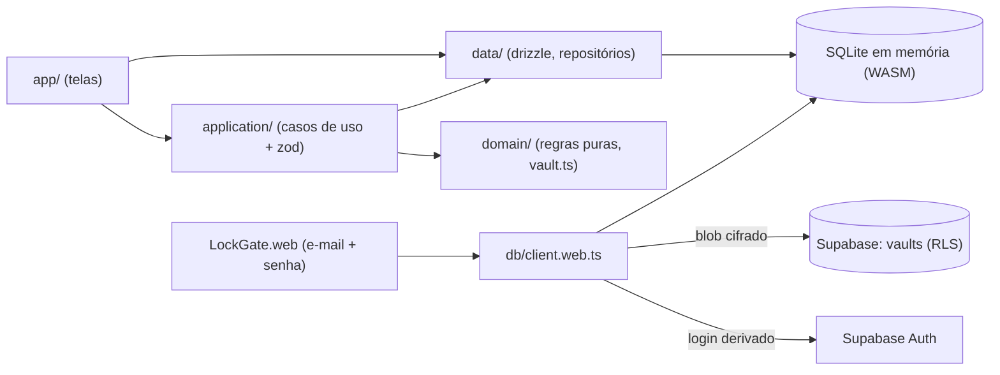

# Arquitetura do appBank (versão web)

Este documento explica **como a aplicação é organizada e por quê**. Para rodar, veja o [README](../README.md). Para riscos e melhorias de segurança, veja [`SECURITY.md`](SECURITY.md).

Esta é a documentação da branch `feature/web-pwa`, a versão publicada na Vercel. A versão nativa original (local-first com SQLCipher e Face ID) está na branch `main`. As diferenças estão na [seção 12](#12-web-e-nativo).

## Sumário

1. [Princípios](#1-princípios)
2. [Visão geral](#2-visão-geral)
3. [Camadas e regras de dependência](#3-camadas-e-regras-de-dependência)
4. [Boot](#4-boot)
5. [Segurança](#5-segurança)
6. [Sincronização](#6-sincronização)
7. [Modelo de dados](#7-modelo-de-dados)
8. [Dinheiro e entradas](#8-dinheiro-e-entradas)
9. [Regras de negócio](#9-regras-de-negócio)
10. [Importações](#10-importações)
11. [Navegação](#11-navegação)
12. [Web e nativo](#12-web-e-nativo)
13. [Estratégia de testes](#13-estratégia-de-testes)
14. [Decisões de projeto](#14-decisões-de-projeto)
15. [Backup em arquivo](#15-backup-em-arquivo)
16. [Dívida técnica e riscos](#16-dívida-técnica-e-riscos)
17. [Como estender](#17-como-estender)

## 1. Princípios

- **Criptografia de ponta a ponta.** O servidor guarda e devolve uma linha cifrada. Chaves e texto em claro só existem na memória do navegador.
- **Uma fonte de verdade por conta.** O banco inteiro é um único blob cifrado no Supabase, com número de versão. Qualquer aparelho com a senha abre o mesmo estado.
- **Nada sensível no aparelho.** Não há sessão, chave nem dado salvo em `localStorage`, `IndexedDB` ou OPFS. A única exceção é o último e-mail usado.
- **Dinheiro é inteiro.** Centavos inteiros; `float` só na formatação.
- **Regras puras, I/O nas bordas.** `domain` não toca banco, rede nem UI.
- **Validar na fronteira.** Entradas da UI passam por `zod` em `application`.

## 2. Visão geral



As telas leem direto de `data` com `useLiveQuery` (drizzle), que reage às mudanças do banco. As escritas passam por `application`. Exceções que escrevem direto no repositório: `archiveGoal` e `deleteGoal` nas telas de meta, `deleteTransactionOrPurchase` na edição de lançamento e o CRUD de categorias, cuja validação fica em `domain/category.ts`.

## 3. Camadas e regras de dependência

| Camada | Pasta | Responsabilidade | Pode importar |
| --- | --- | --- | --- |
| Domínio | `src/domain` | Dinheiro, datas, parcelas, histórico, categorias, metas, orçamento, alertas, conquistas, parsers, formato e criptografia do backup e do cofre. Sem I/O. | `domain`, libs puras (`date-fns`, `@noble/*`) |
| Dados | `src/data` | Schema, conexão, migrations, repositórios, seed, arquivos, sessão. | `domain` |
| Aplicação | `src/application` | Casos de uso: validam (`zod`), convertem texto em centavos e chamam repositórios. | `domain`, `data` |
| Apresentação | `src/app`, `src/components` | Telas, navegação, estado de UI. | todas |

A seta só aponta para dentro. É isso que permite testar as regras com `npx tsx`, sem navegador.

### Mapa de arquivos

```
src/domain/
  money.ts            Cents, parseToCents, formatBRL, formatCentsInput, maskCurrencyInput
  dates.ts            formatDateBR, parseDateBR, maskDateInput, centsToInput
  types.ts            tipos, TEXT_MAX = 250
  installments.ts     splitInstallments, installmentDates, rótulo "(i/n)", irmãs de uma compra
  monthlyHistory.ts   meses passados e futuros, anos, availableCents, gasto por categoria
  category.ts         validação, emojis e cores sugeridos, isSingleEmoji
  goal.ts             goalProgress, parseGoalPeriod
  vault.ts            cofre web: deriveAccount, seal/open, chave de recuperação
  backupCrypto.ts     envelope do arquivo de backup (scrypt + XChaCha20-Poly1305)
  backup.ts           formato e validação do conteúdo do backup
  budgetStatus.ts, goalAlert.ts, savingsSuggestion.ts, achievements.ts, period.ts
  boleto.ts, ofx.ts, pixReceipt.ts
src/data/
  db/client.web.ts    SQLite em memória + Supabase + cofre + autosave + sync + sair
  db/client.ts        versão nativa (SQLCipher)
  db/schema.ts        tabelas (drizzle)
  transactionRepository.ts  lançamentos, parcelas, edição, exclusão de compra
  categoryRepository.ts     criar, editar, excluir categoria
  goalRepository.ts         metas e depósitos
  session.ts / session.web.ts   canSignOut + signOut
  seed.ts             categorias padrão (só em banco vazio)
  backupFile.web.ts, ofxFile.web.ts, webFiles.ts
src/components/
  LockGate.web.tsx    entrar, criar conta, recuperar, rebloquear, puxar mudanças
  HeaderCancel.tsx    goBack(): volta ou cai na aba certa
  PasswordInput.tsx   campo de senha com mostrar/ocultar
src/web/memoryOnlyVFS.js   troca o VFS OPFS do worker do expo-sqlite por memória
```

## 4. Boot

```mermaid
sequenceDiagram
  participant R as RootLayout
  participant C as client.web
  participant L as LockGate.web
  participant S as Supabase
  participant A as AppContent
  R->>C: initSecureDb() abre ":memory:" (async)
  R->>L: tela de entrar
  L->>C: unlockVault(email, senha)
  C->>C: deriveAccount (scrypt + HKDF)
  C->>S: signInWithPassword(email, senhaDeLogin)
  C->>S: select vaults
  alt já existe
    C->>C: open(KEK, wrap_pass) -> DEK; open(DEK, data) -> SQLite
    C->>C: deserialize + backup para o banco em memória
  else conta nova
    C->>S: insert (data, wrap_pass, wrap_recovery, version 1)
    C-->>L: chave de recuperação (mostrada uma vez)
  end
  C->>C: startAutosave()
  L->>A: libera
  A->>A: useMigrations + seed (só em banco vazio)
```

Por que o banco abre de forma assíncrona antes de tudo: o drizzle usa a API **síncrona** do `expo-sqlite`. Na web, cada chamada síncrona espera o worker com um tempo limite curto, e a primeira (subir o worker e carregar o WASM) estouraria esse tempo. Abrir com `openDatabaseAsync` primeiro resolve.

## 5. Segurança

### Derivação de chaves (`domain/vault.ts`)

```
salt   = SHA-256("appbank-account|" + email minúsculo)[0..16]
master = scrypt(NFKC(senha), salt, N=2^15, r=8, p=1, 32 bytes)
senhaDeLogin = hex(HKDF-SHA256(master, info="appbank-login-v1"))   -> Supabase Auth
KEK          = HKDF-SHA256(master, info="appbank-kek-v1")          -> só em memória
```

O sal vem do e-mail para ser conhecido **antes** do login, em qualquer aparelho. O Supabase recebe só a `senhaDeLogin`, da qual não se chega à KEK (HKDF com outro `info`).

### Envelope (cofre)

| Blob | Conteúdo | Cifrado com |
| --- | --- | --- |
| `data` | o SQLite serializado | DEK (32 bytes aleatórios, nunca muda) |
| `wrap_pass` | a DEK | KEK (da senha) |
| `wrap_recovery` | a DEK | HKDF da chave de recuperação (16 bytes aleatórios) |

- Cifra: **XChaCha20-Poly1305** com nonce aleatório de 24 bytes a cada gravação.
- O tipo do blob (`data`, `wrap-pass`, `wrap-recovery`) entra como dado associado (AAD). Trocar um blob por outro falha.
- Chave errada ou blob alterado **falha**, nunca devolve lixo.

### Recuperação de senha

1. "Esqueci a senha" chama `resetPasswordForEmail`, que envia o link do Supabase de volta para o app.
2. O link abre a tela "Criar nova senha" (`#type=recovery`, lido antes do Supabase limpar a URL).
3. A chave de recuperação abre `wrap_recovery` e devolve a DEK. A DEK é recifrada com a KEK da senha nova (`wrap_pass`), com trava de versão.
4. `updateUser({ password: novaSenhaDeLogin })`.

Os dados **não** são recifrados: só a cópia da DEK. Exige as duas coisas, acesso ao e-mail **e** a chave. Quem tem só o e-mail não abre nada.

### Servidor (`supabase/schema.sql`)

- Tabela `vaults` com uma linha por usuário (`user_id` = `auth.uid()`).
- **RLS:** política `own vault` para `authenticated`, com `using` e `with check` em `user_id = auth.uid()`.
- `GRANT select, insert, update` só para `authenticated`. `delete` revogado. `anon` sem acesso (verificado: `permission denied`).
- `data` limitado a 20 MB por `CHECK`.

### Navegador

- **Sessão não persistida** (`persistSession: false`). Recarregar descarta chave e sessão.
- **Rebloqueio:** página oculta por 1 minuto ou mais pede a senha de novo. O rebloqueio só confere a senha contra a KEK em memória, sem rede. É uma trava de interface: as chaves continuam em memória enquanto a aba existir.
- **Sair:** salva o que estiver pendente (recusa se não conseguir), encerra a sessão local e recarrega a página.
- **Cabeçalhos** (`vercel.json`): `COEP: require-corp` e `COOP: same-origin` (isolamento exigido pelo `SharedArrayBuffer`), `X-Content-Type-Options`, `Referrer-Policy: no-referrer`, `X-Robots-Tag: noindex`. A Vercel adiciona HSTS.
- **Por que `require-corp` e não `credentialless`:** o Safari não suporta `credentialless`. A página fica sem isolamento, o `SharedArrayBuffer` não existe e toda consulta do banco falha. O app só carrega recursos próprios e fala com o Supabase via CORS, então `require-corp` funciona nos dois navegadores.

## 6. Sincronização

- **Autosave:** o `addDatabaseChangeListener` agenda a gravação 800 ms depois da última mudança. A gravação serializa o banco, cifra (`seal`) e faz `UPDATE ... WHERE version = <versão carregada>`, com `version + 1`.
- **Trava otimista:** se o `UPDATE` não afetar nenhuma linha, outro aparelho salvou antes. O app avisa ("alterados em outro aparelho"), marca conflito e para de gravar. Não há mesclagem.
- **Sem rede:** marca como pendente, tenta de novo a cada 10 s, avisa uma vez e pede confirmação para fechar a aba com algo pendente.
- **Voltar ao app** (`syncFromServer`): ao reaparecer (volta rápida) ou depois de digitar a senha no rebloqueio, o app grava o pendente, busca a versão do servidor e, se for mais nova, carrega o banco novo e **remonta as telas** (chave do `Fragment` no `LockGate`). Carregar o banco assim não notifica as consultas vivas, por isso a remontagem.
- **Por que isso existe:** o iPhone mantém a página viva por dias em segundo plano. Sem isso, o celular mostrava dados velhos e a próxima gravação dava conflito.

## 7. Modelo de dados

Dentro do SQLite (o mesmo nas duas versões):

```mermaid
erDiagram
  categories ||--o{ transactions : "categoria"
  goals ||--o{ goal_deposits : "depósitos"
  categories { text id PK; text name; text icon; text color; text kind; int budget_cents }
  transactions { text id PK; text category_id FK; int amount_cents; text kind; text description; int occurred_at; text source; text external_id; int created_at }
  goals { text id PK; text name; text icon; text color; int target_cents; int start_at; int end_at; int archived_at; int created_at }
  goal_deposits { text id PK; text goal_id FK; int amount_cents; int occurred_at; int created_at }
```

No Supabase, só `vaults (user_id PK, version, data, wrap_pass, wrap_recovery, updated_at)`.

- **Datas:** `integer` em ms, horário local. Datas digitadas são gravadas ao meio-dia.
- **Parcelas** não têm tabela própria: são lançamentos com a descrição `"Base (i/n)"`, gravados num único `INSERT` com o mesmo `created_at`. "Mesma compra" = mesmo `created_at` + mesma base + mesmo `n` (`installmentSiblings`).
- **Exclusões explícitas:** excluir categoria anula `category_id` dos lançamentos e excluir meta apaga os depósitos, numa transação síncrona. Não dependemos de `ON DELETE`, porque `PRAGMA foreign_keys` não é ativado.
- **Seed:** as 7 categorias padrão só são inseridas se a tabela estiver vazia. Assim, uma categoria excluída não volta.

## 8. Dinheiro e entradas

- `Cents` = inteiro. `parseToCents` aceita `R$ 1.234,56`, `1234,56` e `19.9`, montando os centavos com partes inteiras.
- **Máscara de moeda** (`maskCurrencyInput`): só dígitos, lidos como centavos (`12345` → `123,45`). Até 13 dígitos. Zero vira campo vazio. Teclado `number-pad` (vira `inputmode=numeric` na web).
- **Máscara de data** (`maskDateInput`): `05032026` → `05/03/2026`. `parseDateBR` rejeita datas inexistentes, como 31/02.
- **Textos livres:** até `TEXT_MAX = 250` caracteres, conferido no campo (`maxLength`) e no `zod`. Exceção: nome de categoria, até 30 caracteres.

## 9. Regras de negócio

### Disponível (`availableCents`)

`disponível = entradas − gastos − depósitos líquidos nas metas` do mês. Uma retirada, que é negativa, devolve o valor. É o "Disponível para gastar" do Resumo e o "Sobrou" do Histórico (mês, ano e detalhe). "Saídas" continua sendo só gasto, para orçamento e gastos por categoria não confundirem poupança com despesa.

### Parcelas (`installments.ts`)

- De 2 a 48. `splitInstallments` dá parcelas inteiras que somam o total exato. O resto vai para a 1ª (R$ 100,00 / 3 = 33,34 + 33,33 + 33,33).
- Mesmo dia em cada mês, ajustado no fim do mês (31/01 vira 28/02).
- Na edição de uma parcela, descrição e categoria valem para a compra inteira, e valor e data só para aquela parcela. Excluir apaga todas.
- O Resumo lista só até o fim do mês atual. O que cai em meses futuros aparece como "comprometido".

### Histórico (`monthlyHistory.ts`)

- Meses passados: do mês atual até o mais antigo com dados, **sem buracos** (meses vazios aparecem zerados).
- Meses futuros com lançamentos formam o "Já comprometido".
- Ano: somas, média de gasto pelos meses do ano presentes no histórico, melhor e pior mês pelo disponível.
- Gasto por categoria com porcentagem inteira, do maior para o menor.

### Categorias (`category.ts`)

Nome de 1 a 30 caracteres, espaços colapsados e único por tipo (sem diferenciar maiúsculas). Ícone: exatamente **um** emoji (`Intl.Segmenter`, então 🏋️ e 👨‍👩‍👧 contam como um). Cor `#rrggbb`. O tipo não muda depois de criada.

### Metas (`goal.ts`, `manageGoals.ts`)

- Nome até 250 caracteres, alvo maior que zero, emoji único, cor válida.
- `parseGoalPeriod`: início obrigatório, fim opcional (sem prazo), fim não pode ser antes do início.
- `goalProgress`: restante, razão e meta mensal = `ceil(restante / meses de hoje até o fim, contando o atual)`. Conta a partir de **hoje**, não do início.
- Depósito diferente de zero; negativo é retirada.

### Orçamento, alertas, sugestão e conquistas

Inalterados em relação ao nativo: `budgetStatus` (70% atenção, acima de 100% estourou, em inteiros), `goalAlerts` (marcos de 25, 50, 75 e 90%), `suggestSavings` (heurística de 3 meses) e `computeAchievements` (5 selos derivados). Atenção: a sugestão usa `entradas − gastos` e ainda não desconta as metas.

## 10. Importações

Boleto (47 dígitos, fator de vencimento com reinício em 2025), PIX (heurística, com confirmação) e OFX (`FITID` para deduplicar, importa sem categoria). Na web, o arquivo OFX é lido com `<input type="file">` (`webFiles.ts`).

## 11. Navegação

| Rota | Arquivo | Tipo |
| --- | --- | --- |
| `/` | `(tabs)/index.tsx` | Aba Resumo (com "Sair" na web) |
| `/goals` | `(tabs)/goals.tsx` | Aba Metas |
| `/history` | `(tabs)/history.tsx` | Aba Histórico (Meses / Anos, comprometido, link de backup) |
| `/budgets` | `(tabs)/budgets.tsx` | Aba Orçamento (link para categorias) |
| `/add` | `add.tsx` | Modal novo lançamento; `?id=` edita |
| `/goal-new` | `goal-new.tsx` | Modal nova meta; `?id=` edita e exclui |
| `/deposit` | `deposit.tsx` | Modal guardar/retirar e arquivar (`goalId`) |
| `/month/[key]` | `month/[key].tsx` | Detalhe do mês (`2026-11`) |
| `/categories` | `categories.tsx` | Gerenciar categorias (`?kind=` abre criando) |
| `/import`, `/backup`, `/achievements` | | Importar, backup, conquistas |

- **Saída sempre possível:** toda tela fora das abas tem "Cancelar" ou "‹ Voltar". Depois de salvar, `goBack(fallback)` volta para a tela anterior ou, sem histórico (página recarregada, atalho do iPhone), para a aba certa. Antes, `router.back()` não fazia nada nesse caso e a tela ficava aberta.
- **Vercel:** `cleanUrls` serve `/history` como `history.html`. A reescrita `/month/:key → /month/[key]` permite abrir o detalhe do mês direto pela URL.

## 12. Web e nativo

| Peça | Nativo (`main`) | Web |
| --- | --- | --- |
| Banco | SQLCipher, arquivo no aparelho | SQLite WASM em `:memory:`, persistido como blob cifrado |
| Chave | 32 bytes no Keychain/Keystore | DEK aleatória, aberta pela senha ou pela chave de recuperação |
| Desbloqueio | Biometria/senha do aparelho | E-mail + senha; rebloqueio após 1 min oculto |
| Vários aparelhos | Só por backup em arquivo | Automático, via Supabase |
| VFS do SQLite | n/a | `memoryOnlyVFS.js` no lugar do `AccessHandlePoolVFS` (OPFS) |

**Por que trocar o VFS:** o worker do `expo-sqlite` abria um pool de arquivos OPFS na inicialização, mesmo usando só `:memory:`. Esses arquivos são exclusivos por origem: uma segunda aba, ou o Safari e o atalho ao mesmo tempo, falhava com `createSyncAccessHandle`. O `metro.config.js` resolve o import `./wa-sqlite/AccessHandlePoolVFS` do worker para `src/web/memoryOnlyVFS.js`, que devolve um `MemoryVFS`.

Outros ajustes só da web: `webAlert.ts` (o `Alert.alert` do React Native Web não faz nada, então ele é ligado a `alert`/`confirm`), `PwaHead.tsx` (manifest e ícones; o `+html.tsx` foi descartado porque impedia a injeção dos scripts no export estático) e `public/` (manifest e ícones).

## 13. Estratégia de testes

| Arquivo | Garante |
| --- | --- |
| `money.test.ts` | Conversão e soma exatas; máscara de moeda tecla a tecla, colar, apagar e limite |
| `dates.test.ts` | dd/mm/aaaa válido e inválido (31/02, bissexto); máscara de data; ida e volta de centavos |
| `installments.test.ts` | Parcelas exatas, datas no fim do mês, rótulo, irmãs; histórico mensal e anual; disponível; gasto por categoria; `monthRange` |
| `category.test.ts` | Nome, emoji único, cor, duplicado por tipo |
| `goal.test.ts` | Progresso, meta mensal, `parseGoalPeriod`, `isSingleEmoji`; sugestão de economia |
| `vault.test.ts` | Selar e abrir; chave errada, adulteração e troca de tipo rejeitadas; login ≠ KEK; recuperação reabre os dados antigos |
| `backupCrypto.test.ts`, `backup.test.ts` | Arquivo de backup |
| `budgetStatus.test.ts`, `goalAlert.test.ts`, `boleto.test.ts`, `ofx.test.ts` | Orçamento, alertas, boleto, PIX, OFX |

A interface foi validada com scripts Playwright (Chrome e WebKit) contra um Supabase **simulado**: criar conta, recuperar, dois aparelhos, conflito, sem rede, Safari, abas múltiplas, máscaras, parcelas, categorias e metas. Esses scripts não ficam no repositório.

## 14. Decisões de projeto

| Decisão | Motivo | Consequência |
| --- | --- | --- |
| PWA em vez de app nativo | Sem conta Apple Developer e sem Mac | Sem Face ID nativo; depende de navegador e rede |
| Supabase como cofre, não como banco | Dados em qualquer aparelho sem expor o conteúdo | Servidor não consulta nada; todo o banco vai e volta |
| Um blob por conta | Simples, atômico, versão única | Upload inteiro a cada mudança; sem mesclagem |
| DEK + duas cópias embrulhadas | Recuperar a senha sem recifrar os dados | Perder senha **e** chave = perder os dados |
| Sal derivado do e-mail | Derivar a chave antes do login | Pré-cálculo por e-mail possível (ver SECURITY.md) |
| Sessão não persistida | Nada sensível no aparelho | Senha a cada recarga |
| COEP `require-corp` | Safari | Recursos de outra origem precisam de CORP/CORS |
| Troca do VFS OPFS | Abas múltiplas no iPhone | Sem armazenamento local persistente do SQLite |
| Máscaras de entrada | Celular sem vírgula fácil | Valores sempre com 2 casas |

## 15. Backup em arquivo

Exportação lógica das tabelas (`readSnapshot`) em JSON, cifrada com uma senha própria: scrypt N=2¹⁵, r=8, p=1, sal de 16 bytes e XChaCha20-Poly1305, com o cabeçalho como AAD. A restauração valida tudo com `zod` e referências, e mescla numa transação: categorias por *upsert*, o resto por *insert or ignore*. Restaurar duas vezes não duplica.

Na web, o arquivo é entregue pela folha de compartilhar (`navigator.share`) ou como download (`backupFile.web.ts`), e lido com `<input type="file">`. Ao mudar o schema, toda coluna nova precisa entrar em `domain/backup.ts`, com aumento de `BACKUP_VERSION`.

## 16. Dívida técnica e riscos

1. **Senha a cada recarga.** Próximo passo planejado: Face ID via passkey (WebAuthn PRF), com PIN por aparelho como reserva.
2. **Sem cache offline nem histórico de versões no servidor.** Um erro do usuário se propaga para todos os aparelhos.
3. **Upload do banco inteiro** e limite de 1 MB por consulta síncrona.
4. **CI não publicado** (token sem escopo `workflow`).
5. **Sugestão de economia** ainda usa `entradas − gastos`.
6. **Meta mensal** conta a partir de hoje, mesmo com início no futuro.
7. **Sem `CHECK` no SQLite** para valores; a garantia é de `application` e da validação do backup.
8. **Telas carregam a tabela `transactions` inteira** e filtram no cliente.
9. **`randomId` duplicado** em repositórios.
10. Itens de segurança em [`SECURITY.md`](SECURITY.md).

## 17. Como estender

- **Regra nova:** função pura em `domain/` + `nome.test.ts` ao lado; repositório e caso de uso se precisar de dados.
- **Coluna ou tabela nova:** `schema.ts` → `npx drizzle-kit generate` → commitar `.sql`, `_journal.json` e `migrations.js` → atualizar `domain/backup.ts`. O cofre não muda: ele guarda o SQLite inteiro.
- **Tela nova:** arquivo em `src/app/`. Fora das abas, registre em `_layout.tsx` com `modal` ou `pushed` (que trazem o botão de saída) e feche com `goBack(fallback)`, nunca `router.back()`.
- **Algo diferente só na web:** crie `arquivo.web.ts` ao lado de `arquivo.ts`, com a mesma API.
- **Campo de dinheiro ou data:** `maskCurrencyInput` / `maskDateInput` + `keyboardType="number-pad"`. Texto livre: `maxLength={TEXT_MAX}`.
